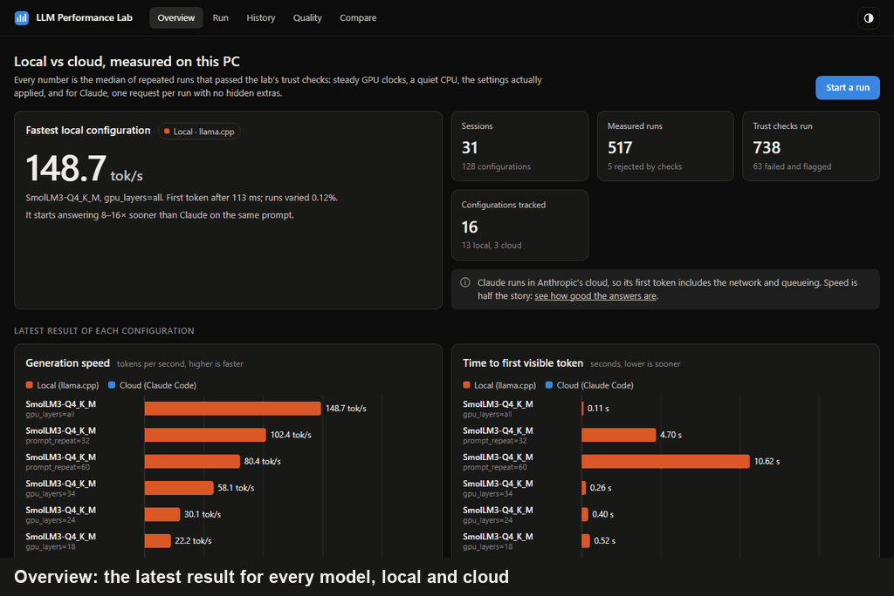
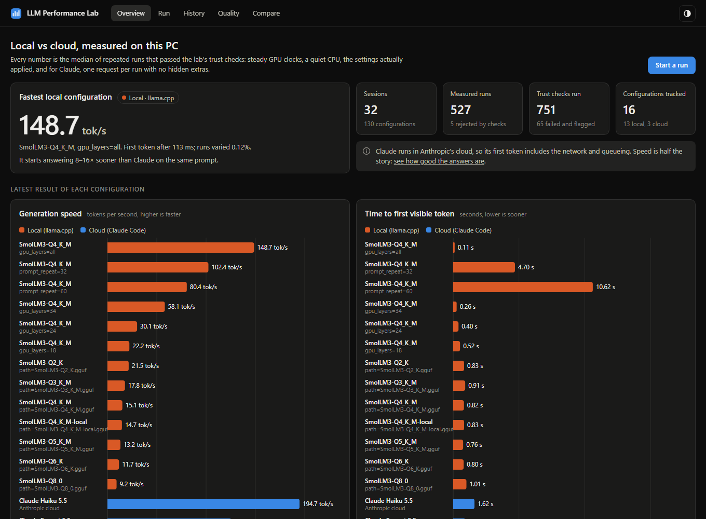
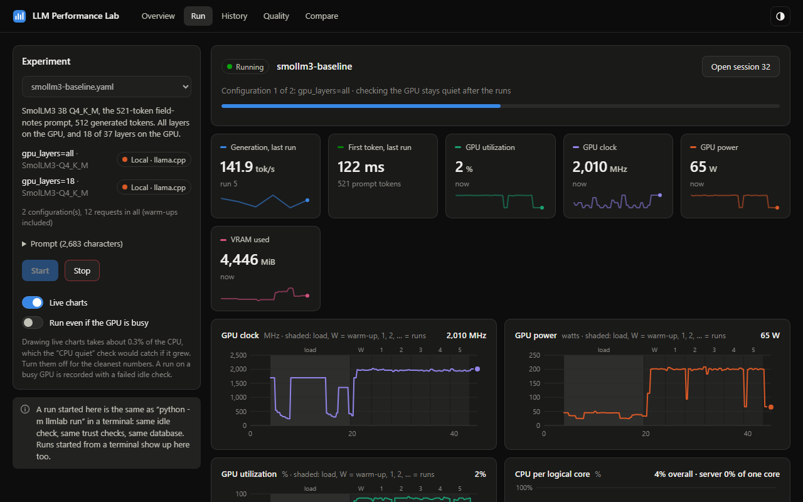
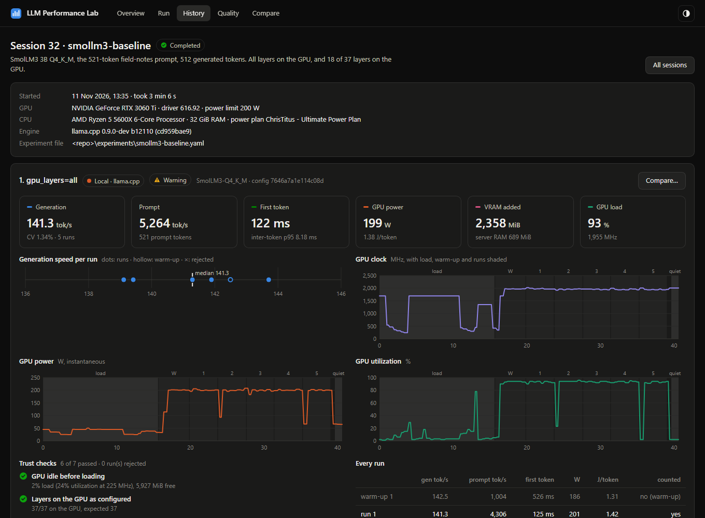
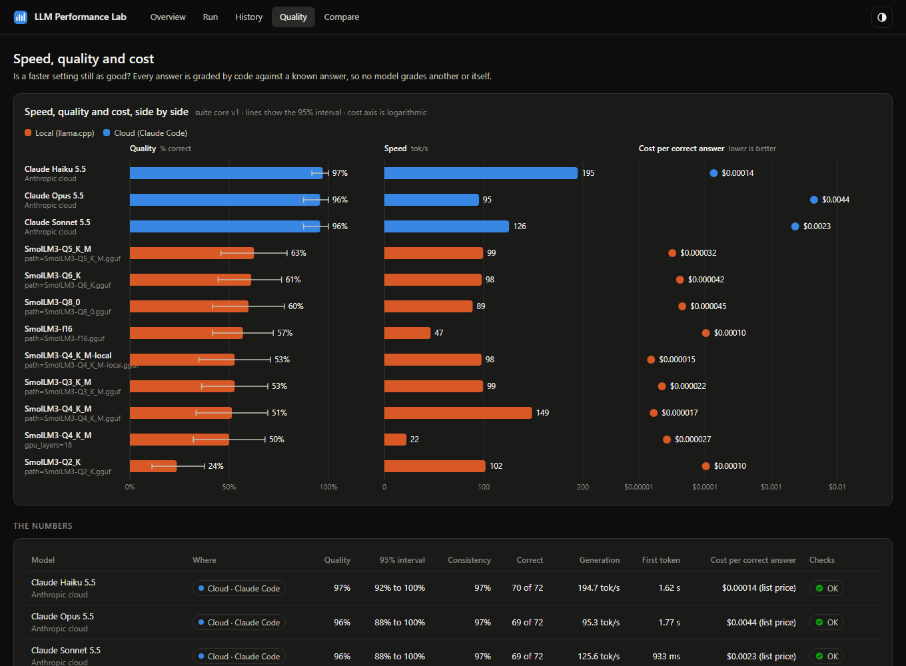
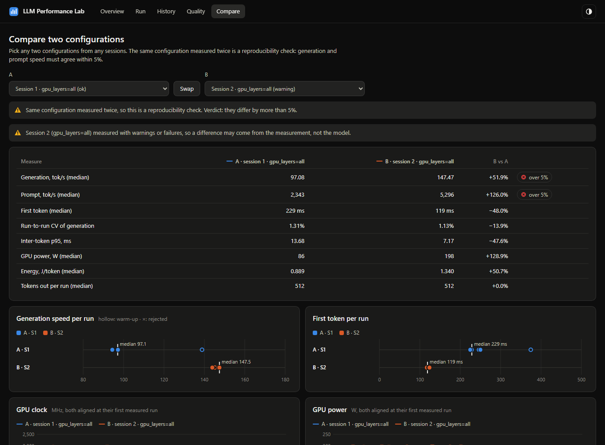
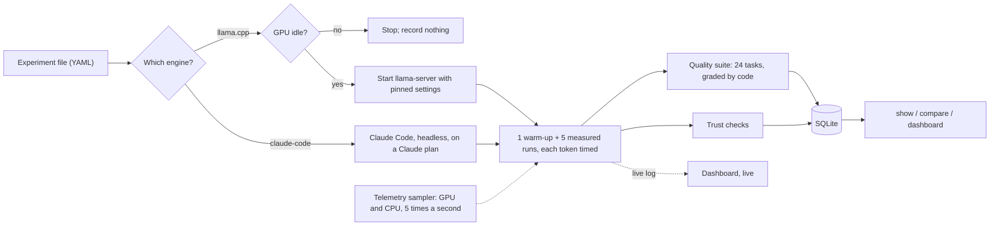

# Local LLM Performance Lab

**Benchmarks language models on your own GPU against Claude in the cloud: speed, answer quality and cost, with checks on its own measurements so the numbers can be trusted.**


A 3B model on a mid-range gaming GPU starts answering 8–18× sooner than Claude and streams faster than Sonnet and Opus, but it gets about half of the graded tasks right where Claude gets 96–97%. Every answer is graded by code, so no model grades another or itself. [Full results →](#results)

## Try it in a minute, no GPU needed



The demo opens the dashboard on every result recorded while this project was built: 32 sessions on an RTX 3060 Ti, with Claude Haiku, Sonnet and Opus as the cloud baseline. Nothing in it is made up, and the runs that failed their checks are still there with the reason. It needs only [uv](https://docs.astral.sh/uv/getting-started/installation/), which fetches Python 3.13 and the four dependencies itself:

```bash
git clone https://github.com/Renis032/LocalLLMPerformanceLab.git
cd LocalLLMPerformanceLab
uv run python -m llmlab demo
```

Your browser opens at `http://127.0.0.1:8765`. Starting runs is off in the demo; [Quick start](#quick-start) runs real experiments on your own GPU. Without uv, use Python 3.13 or later: `pip install httpx nvidia-ml-py psutil pyyaml`, then `python -m llmlab demo`.

## At a glance

| | |
|---|---|
| **What it does** | Runs a local model on llama.cpp with pinned, verified settings, and Claude (Haiku, Sonnet, Opus) through Claude Code as a cloud baseline. Measures generation and prompt speed, time to first token, inter-token latency, VRAM, RAM, power, energy per token, cost and answer quality, and stores every run and answer in SQLite |
| **Quality** | 24 original tasks graded by code against known answers: exact match, JSON, coding against hidden tests, multi-step reasoning. Every grader is tested on a known-right and a known-wrong answer before a run counts |
| **What makes it different** | 21 automatic trust checks (10 local, 7 cloud, 4 for quality) decide which results count. Building it uncovered [11 measurement pitfalls](docs/measurement-findings.md), each now guarded against, including one in its own dashboard |
| **Reproducible** | The same local experiment run twice back to back agrees within 1.0% on generation speed (model on the GPU) and 1.7% (split across CPU and GPU). Six hours apart: 3.0% and 5.8%, the second an [open question](docs/measurement-findings.md#open-questions) |
| **Dashboard** | Start a run and watch GPU clock, power, utilization and per-core CPU live; browse every session; overlay any two configurations. Standard-library server and hand-drawn SVG charts: nothing to build. A [demo](#try-it-in-a-minute-no-gpu-needed) runs it on the recorded results, with no GPU or model |
| **Stack** | Python 3.13 · llama.cpp (CUDA) · Claude Code (headless) · NVIDIA NVML · SQLite · JavaScript and SVG · pytest (180 tests, no GPU or network needed) |
| **Status** | 5 of 8 phases done: the measurement harness, the Claude baseline, the dashboard and quality scoring. Phase 5 (GPU offload, quantization, context length) has its first pass recorded; its reports are next ([roadmap](#roadmap)) |

## Results

### Speed, quality and cost

24 graded tasks, three repeats each (72 answers per model) · RTX 3060 Ti 8 GB · Ryzen 5 5600X. Speed is each configuration's latest run that passed its checks, so it differs a little from the earlier speed-only sessions below.

| Model | Runs on | Quality (95% interval) | Consistency | Generation | Cost per correct answer |
|---|---|---|---|---|---|
| SmolLM3 3B (Q4_K_M) | this PC, llama.cpp | **51%** (33–69%) | 82% | 148.7 tok/s | **$0.000017** of GPU electricity⁴ |
| Claude Haiku 5.5 | Anthropic cloud | **97%** (92–100%) | 97% | 194.7 tok/s | $0.00014² |
| Claude Sonnet 5.5 | Anthropic cloud | **96%** (88–100%) | 97% | 125.6 tok/s | $0.0023² |
| Claude Opus 5.5 | Anthropic cloud | **96%** (88–100%) | 97% | 95.3 tok/s | $0.0044² |

| Share correct | Exact match | JSON generation | Coding | Reasoning |
|---|---|---|---|---|
| SmolLM3 3B | 22% | 56% | 50% | 78% |
| Claude Haiku 5.5 | 89% | 100% | 100% | 100% |
| Claude Sonnet 5.5 | 83% | 100% | 100% | 100% |
| Claude Opus 5.5 | 83% | 100% | 100% | 100% |

- **Claude is right about twice as often.** The gap is 46 points against Haiku (95% interval 28 to 63), well beyond what 24 tasks can blur.
- **The local model is cheapest per correct answer, but only 8× cheaper than Haiku,** and that leaves out the price of the GPU. Haiku is the better value here: nearly twice the quality for a fraction of a cent.
- **This suite can't separate the three Claude models.** Their intervals overlap. Sonnet and Opus lose their points on one task: asked to reply with only a count, they list the numbers first. Haiku's misses are on reversing a word.
- **A faster setting can cost nothing.** Moving 19 of 37 layers to the CPU made the model 7× slower and changed its quality by −1.4 points (95% interval −8.3 to +4.2): no detectable difference, as expected from the same weights.
- **SmolLM3 loses most on exact tasks,** such as giving the order number instead of the invoice number, or explaining an answer it was told to give alone.

⁴ GPU board energy over the whole suite at $0.20/kWh, an assumed price. It leaves out the CPU, the rest of the PC and the GPU's purchase price.

### Local model vs Claude

Same 521-token prompt everywhere · median of 5 runs.


| Model | Runs on | Generation | First visible token | Run-to-run CV | Tokens out | Cost per run |
|---|---|---|---|---|---|---|
| SmolLM3 3B (Q4_K_M) | this PC, llama.cpp | **153.8 tok/s** | **0.10 s** | 0.24% | 512 (fixed) | 1.30 J/token of GPU energy |
| Claude Haiku 5.5 | Anthropic cloud | **186.2 tok/s** | 1.64 s¹ | 2.54% | 1,196 | $0.0007² |
| Claude Sonnet 5.5 | Anthropic cloud | 118.8 tok/s | 0.84 s | 5.30% | 1,115 | $0.014² |
| Claude Opus 5.5 | Anthropic cloud | 93.9 tok/s | 1.78 s | 2.63% | 1,096 | $0.027² |

- **The local model answers first.** It has no network round trip or queue, so its first token arrives 8–18× sooner.
- **Haiku streams fastest;** the 3B model beats Sonnet and Opus.
- **Cloud speed is less steady:** run-to-run variation is 10–22× higher than on the local GPU.

¹ Includes about 95 hidden thinking tokens (0.44 s): Haiku 5.5 thinks even when Claude Code is told not to, and the harness caught it ([finding 7](docs/measurement-findings.md#7-claude-haiku-55-thinks-even-when-told-not-to)).
² At API list prices. These runs used a Claude plan through Claude Code, with no API key, so they counted against the plan's usage limits instead.
Claude's answers vary in length because Claude Code can't stop at a fixed count ([finding 8](docs/measurement-findings.md#8-capping-claudes-output-turns-one-run-into-several-requests)). Speeds are per token, and each model family has its own tokenizer, so speeds compare only approximately across families.

### Local model: all on the GPU vs split with the CPU

| Configuration | Generation | Prompt | First token | Run-to-run CV | VRAM added | GPU power | Energy |
|---|---|---|---|---|---|---|---|
| All 37 layers on the GPU | **153.8 tok/s** | 5,537 tok/s | 100 ms | 0.24% | 2,313 MiB | 200 W (at its limit) | 1.30 J/token |
| 18 of 37 layers on the GPU | **22.6 tok/s** | 1,156 tok/s | 453 ms | 0.25% | 1,361 MiB + 1,687 MiB RAM | 41 W | 1.84 J/token³ |

Moving half the layers to the CPU makes generation **6.8× slower**. The CPU half sets the pace: the server keeps six cores busy while the GPU sits about 70% idle.

³ GPU board power only. CPU energy isn't measured yet.

### Reproducibility

The same local experiment, run twice (sessions 3 and 4):

| Configuration | Generation, run 1 → run 2 | Prompt, run 1 → run 2 | Verdict (5% tolerance) |
|---|---|---|---|
| All layers on the GPU | 152.2 → 153.8 tok/s (+1.0%) | 5,488 → 5,537 tok/s (+0.9%) | Pass |
| 18 of 37 layers on the GPU | 22.2 → 22.6 tok/s (+1.7%) | 1,238 → 1,156 tok/s (−6.6%) | Generation passes; prompt speed is a [known open question](docs/measurement-findings.md#open-questions) |

Six hours later (session 10, near midnight), the model on the GPU generated 3.0% slower, inside the bar, and the split configuration 5.8% slower, outside it, though both sessions passed every check. Eight sessions that night agreed within 2.4% of each other, so something changed between afternoon and night that the checks don't see yet: another [open question](docs/measurement-findings.md#open-questions).

Claude, run twice about 40 minutes apart (sessions 6 and 7; the second was started from the dashboard): Sonnet +3.0% and Opus +1.6% pass, and Haiku +5.5% misses the 5% bar. Cloud speed depends on Anthropic's load at the time, which no client can control.

Quality repeats exactly: the local suite run twice on the same day (sessions 16 and 17) gave 37 of 72 correct both times, with fixed seeds. The [date in the prompt is pinned](docs/measurement-findings.md#11-a-chat-template-puts-todays-date-in-every-prompt), so the prompts stay identical on other days too.

## Dashboard



| Page | Purpose |
|---|---|
| **Overview** | The headline numbers, local vs cloud |
| **Run** | Start an experiment and watch it live: each request's speed, GPU clock, power, utilization, VRAM and per-core CPU, with warm-up and measured runs shaded |
| **History** and **Session** | Every session, and for each one the spread of runs, telemetry over time, and every trust check with its evidence |
| **Quality** | Speed, quality and cost side by side; results by category and by task; every answer and how it was graded |
| **Compare** | Any two configurations with their telemetry overlaid. It shows [finding 1](docs/measurement-findings.md#1-pauses-between-runs-let-the-gpu-downclock) straight from the database, and says whether quality differs beyond what the tasks can show |

| | |
|---|---|
|  |  |
| **Run:** a live run with its telemetry | **Session:** every run and every check, kept |
|  |  |
| **Quality:** graded answers, speed and cost | **Compare:** does a result repeat? |

```bash
uv run python -m llmlab dashboard
```

Watching a run live costs about 0.3% of the CPU, measured. The first version's pulsing "Running" dot cost ten times that, and slowed the run it was watching by 3% ([finding 10](docs/measurement-findings.md#10-watching-a-run-live-slowed-it-down)).

More screenshots and how it works: [docs/dashboard.md](docs/dashboard.md).

## How it works



1. **Describe the experiment** in a YAML file: the model, its settings, the prompt and the number of runs. A `sweep` turns one file into several configurations, for example `gpu_layers: [all, 18]` or three Claude models.
2. **For a local model,** the harness checks the machine is quiet, starts llama-server with settings that can't drift, and streams each request, timing every token as it arrives. A separate sampler process records GPU utilization, clocks, power, VRAM and temperature, and CPU per core.
3. **For Claude,** it sends the same prompt through Claude Code's headless mode with everything an agent adds switched off: tools, MCP servers, settings files and prompt caching. It times every streamed chunk. No API key is needed.
4. **Trust checks** decide which runs count. Everything (settings, logs, every run, every sample) goes into one SQLite file, and `compare` tests whether two sessions agree.
5. **Quality scoring** is optional. After the speed runs the model answers a fixed suite through its normal chat format, and code grades every answer: exact match, JSON checks, generated programs against hidden tests in a guarded subprocess, or a known final answer. Answers are stored, so a grader fix needs no new requests.
6. **The dashboard** follows a run through a live log the runner writes, and reads the database read-only, so watching never blocks a run.

## Trust checks


The same model on the same GPU measured 97 or 154 tokens per second, depending only on a 1-second pause between runs. Every other check passed, so nothing looked wrong. A check now catches this automatically. [How it was found →](docs/measurement-findings.md#1-pauses-between-runs-let-the-gpu-downclock)

| Check | Why it exists | Seen on this PC |
|---|---|---|
| GPU idle before loading | A game or video in the background shares the GPU with the benchmark | A game at 99% GPU; the run was refused |
| Settings actually applied (layers on the GPU, context size, Flash Attention, …) | llama-server can change settings on its own to fit memory | Nothing yet; confirmed from the server's log for every configuration |
| Exactly 512 tokens generated, full prompt processed | Speeds compare only for the same work; a cached prompt fakes prompt speed | Nothing yet; prompt caching, on by default in two separate ways, is turned off |
| Client and server agree on speed (within 5%) | The reported speed must be what a user actually receives | Nothing yet; within 0.04% across all 138 runs |
| GPU clock steady during runs | A downclocked GPU measures power management, not the model | 97 vs 154 tok/s (the figure above) |
| CPU quiet during runs | Background apps slow the CPU-side work of generation | Fired in 10 configurations; one had 24× the usual run-to-run variation, and in 4 the culprit was this project's own dashboard ([finding 10](docs/measurement-findings.md#10-watching-a-run-live-slowed-it-down)) |
| GPU quiet after the runs | Catches another program using the GPU mid-session | Nothing yet |
| Claude: one API request per run | Claude Code continues by itself when an answer reaches a limit | 3 requests merged into one run when output was capped |
| Claude: no hidden thinking (when off) | Thinking delays the first visible text | Haiku 5.5 thought on every run although told not to |
| Claude: our stream timing matches Claude Code's own | Two independent clocks confirm each other | Disagreed by 0.2–0.4 s, which is how Haiku's thinking was found |
| Claude: requested model, no cached prompt, natural end, same input every run | A fallback model, a cache or extra context would change what is measured | Nothing yet |
| Quality: graders verified on known answers | A broken grader would give a confident wrong score | Nothing yet; every task is tested both ways before each suite |
| Quality: every task answered, answers ended by themselves, each measured once | A gap, a cut-off answer or a fallback model would distort the score | SmolLM3 got lost and hit the token limit on one answer per run |
| Two sessions agree (`compare`) | The definition of reproducible | Within 1.0–1.7% on local generation speed back to back; the split configuration failed six hours apart (−5.8%) |

The full list with thresholds is in [docs/reference.md](docs/reference.md#trust-checks).

## Quick start

To look around first, run the [demo](#try-it-in-a-minute-no-gpu-needed). To measure your own machine, on Windows with an NVIDIA GPU, uv and a llama.cpp build ([setup](docs/setup.md)):

```bash
uv run python -m llmlab run experiments/smollm3-baseline.yaml
```

```bash
uv run python -m llmlab compare 3 4
```

The Claude baseline needs Claude Code installed and signed in to a Claude plan. It doesn't need an API key:

```bash
uv run python -m llmlab run experiments/claude-baseline.yaml
```

Or do it all from the dashboard:

```bash
uv run python -m llmlab dashboard
```

`--dry-run` checks an experiment file without running it. `show` prints a session's runs, medians and checks. All commands are in [docs/reference.md](docs/reference.md#commands).

## Project structure

| Path | Purpose |
|---|---|
| [`llmlab/runner.py`](llmlab/runner.py) | Runs an experiment end to end and applies the local trust checks |
| [`llmlab/llamacpp.py`](llmlab/llamacpp.py) | Starts llama-server with pinned settings, streams completions, parses its log |
| [`llmlab/claude_code.py`](llmlab/claude_code.py) | Sends a prompt to Claude through Claude Code's headless mode and times its stream |
| [`llmlab/cloud.py`](llmlab/cloud.py) | Runs a Claude configuration and applies the cloud trust checks |
| [`llmlab/sampler.py`](llmlab/sampler.py) | Telemetry process: GPU through NVML, plus CPU, five times a second |
| [`llmlab/telemetry.py`](llmlab/telemetry.py) | Controls the sampler; idle checks; clock-weighted GPU load |
| [`llmlab/config.py`](llmlab/config.py) | Reads and validates experiment files; expands sweeps |
| [`llmlab/stats.py`](llmlab/stats.py) | Medians, percentiles, run-to-run variation |
| [`llmlab/db.py`](llmlab/db.py) | SQLite storage, with schema versions and migrations |
| [`llmlab/report.py`](llmlab/report.py) | Terminal reports and session comparison |
| [`llmlab/host.py`](llmlab/host.py) | Records the machine a session ran on |
| [`llmlab/cli.py`](llmlab/cli.py) | The command line: `run`, `sessions`, `show`, `compare`, `quality`, `regrade`, `dashboard`, `demo` |
| [`llmlab/demo.py`](llmlab/demo.py) | The demo: unpacks the recorded results and opens the dashboard on them; rebuilds them without private paths |
| [`llmlab/quality/`](llmlab/quality/) | Answer quality: `suite.py` (task files), `scorers.py` (grading), `sandbox.py` (generated code, guarded), `run.py` (asking the engine), `summary.py` (scores and their uncertainty) |
| [`llmlab/live.py`](llmlab/live.py) | The live log a run writes and the dashboard reads; stop requests |
| [`llmlab/dashboard/`](llmlab/dashboard/) | The dashboard: `server.py` (web server, starting and stopping runs), `api.py` (data as JSON), `static/` (the page and its SVG charts) |
| [`experiments/`](experiments/) | Experiment files |
| [`prompts/`](prompts/) | Prompt texts |
| [`evals/`](evals/) | Graded task suites |
| [`demo/`](demo/) | The recorded results the demo opens, with home-folder paths removed |
| [`tests/`](tests/) | Offline tests, with stand-ins for llama-server and Claude Code |
| [`spike/`](spike/) | Phase 0: cross-checks NVML against nvidia-smi |
| [`docs/`](docs/) | Findings, dashboard, reference, setup, and the figure scripts |

## Tests

180 tests run in under two minutes with no GPU, model or network. [`tests/fake_llama_server.py`](tests/fake_llama_server.py) stands in for llama-server, and [`tests/fake_claude_code.py`](tests/fake_claude_code.py) for Claude Code. Each test file opens with its purpose.

| File | What it protects |
|---|---|
| [`test_runner.py`](tests/test_runner.py) | Whole local experiments end to end. Every trust check passes on good data and fails on the bad data seen on real hardware |
| [`test_cloud.py`](tests/test_cloud.py) | The Claude baseline: a real recorded stream is timed correctly, and each cloud check catches its problem |
| [`test_dashboard.py`](tests/test_dashboard.py) | The live log, stopping a run cleanly, and the dashboard server: its numbers, starting and stopping runs, and refusing requests from other hosts and sites |
| [`test_quality.py`](tests/test_quality.py) | A quality score means what it claims: every grader accepts a right answer and rejects a wrong one, the answer key is worked out independently, generated code stays contained, and whole runs record failures honestly |
| [`test_config.py`](tests/test_config.py) | Mistakes in experiment files are caught before a run; sweeps; matching configurations across sessions |
| [`test_llamacpp.py`](tests/test_llamacpp.py) | The server command and lifecycle; log parsing, tested against a real llama.cpp log |
| [`test_telemetry.py`](tests/test_telemetry.py) | The sampler process; clock-weighted GPU load; CPU used by other programs |
| [`test_report.py`](tests/test_report.py) | `compare` verdicts, including differences explained by warnings |
| [`test_stats.py`](tests/test_stats.py) | Medians, percentiles and variation, against hand-computed values |
| [`test_db.py`](tests/test_db.py) | Storage, schema migrations and model file hashes |
| [`test_demo.py`](tests/test_demo.py) | The demo opens without a GPU or model and can't start runs, and the published results contain no home folder or user name |

```bash
uv run pytest -q
```

## Roadmap

| Phase | Goal | Status |
|---|---|---|
| 0 | Measurement spike: check the measurements agree | Done |
| 1 | Benchmark harness: experiments, trust checks, SQLite, comparison | Done |
| 2 | Claude (Opus, Sonnet, Haiku) as a clearly labelled cloud baseline | Done |
| 3 | Dashboard: live charts, per-core CPU, comparisons | Done |
| 4 | Quality scoring: is a faster setting still as good? | Done |
| 5 | Core experiments: GPU offload, quantization, context length | In progress: first pass recorded, second pass and reports next |
| 6 | Advanced: batching, concurrency, KV-cache types, threads, speculative decoding, bottleneck analysis | |
| 7 | Open-source release | Started: public repository, MIT license, a demo that runs anywhere |

## Documentation

- [Measurement findings](docs/measurement-findings.md): the eleven pitfalls, with evidence.
- [Dashboard](docs/dashboard.md): its pages, how it follows a live run, its API and safety.
- [Reference](docs/reference.md): commands, experiment files, checks, statistics and the database.
- [Setup](docs/setup.md): machine layout, downloads with checksums, the quantization ladder, and the Phase 0 spike.
- [Demo data](demo/README.md): what the demo contains and what was changed before publishing.

## License

[MIT](LICENSE).
