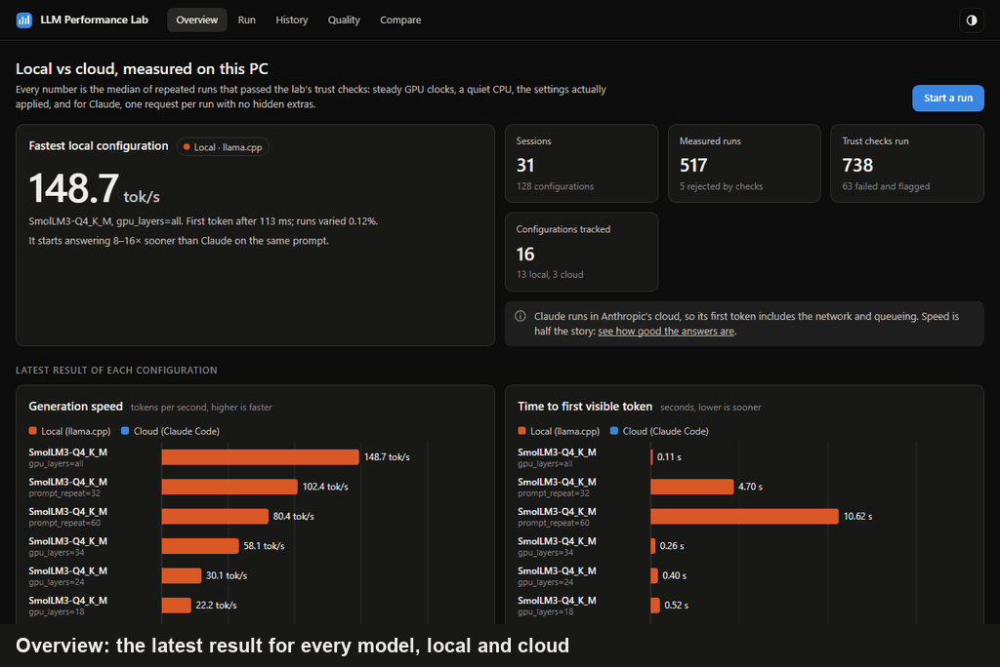
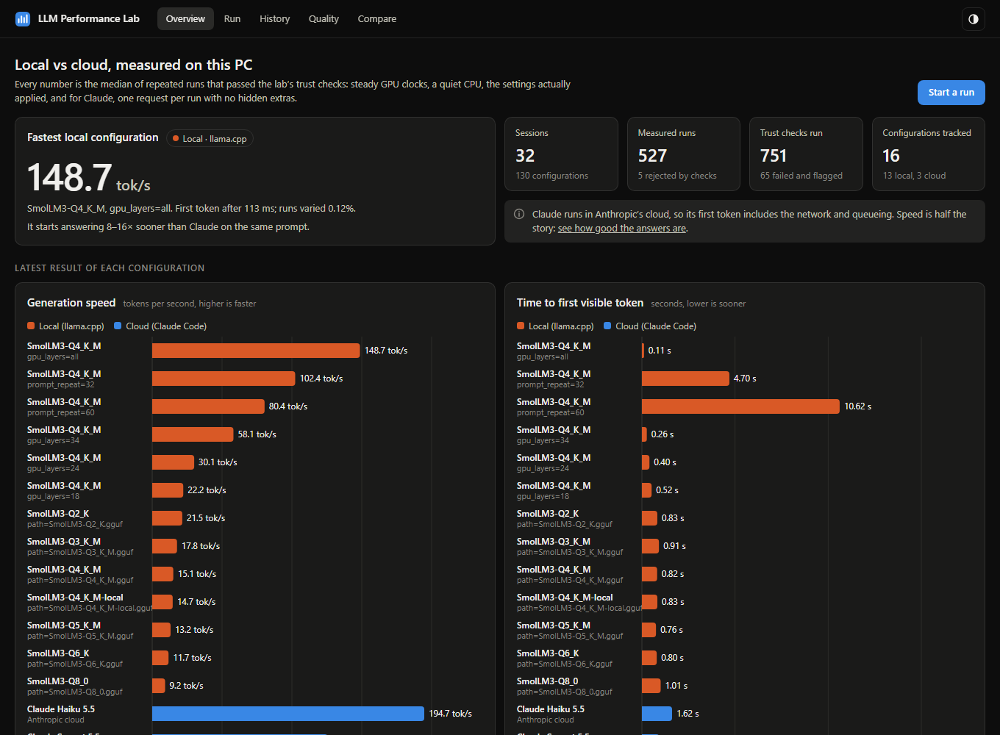
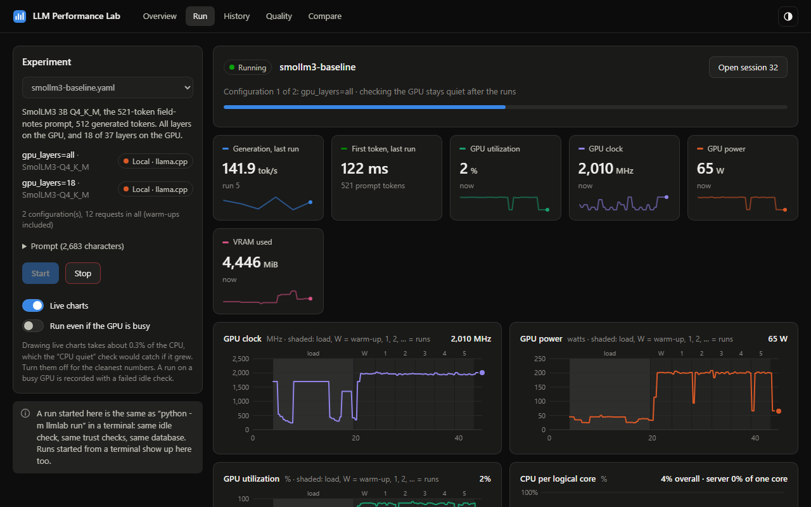
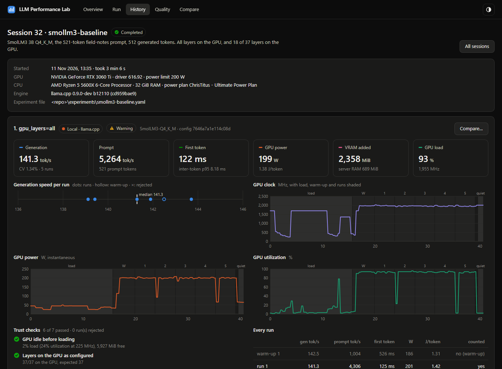
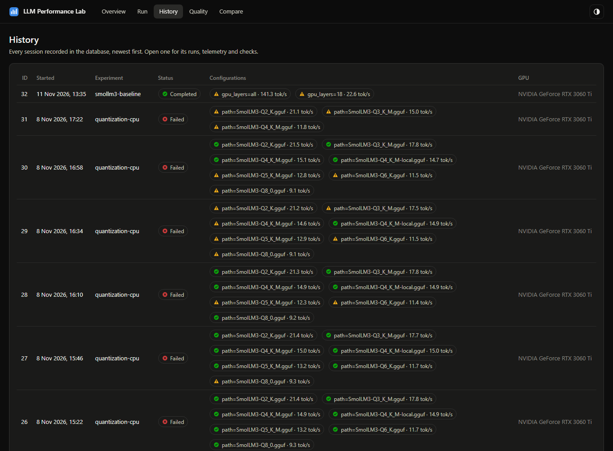
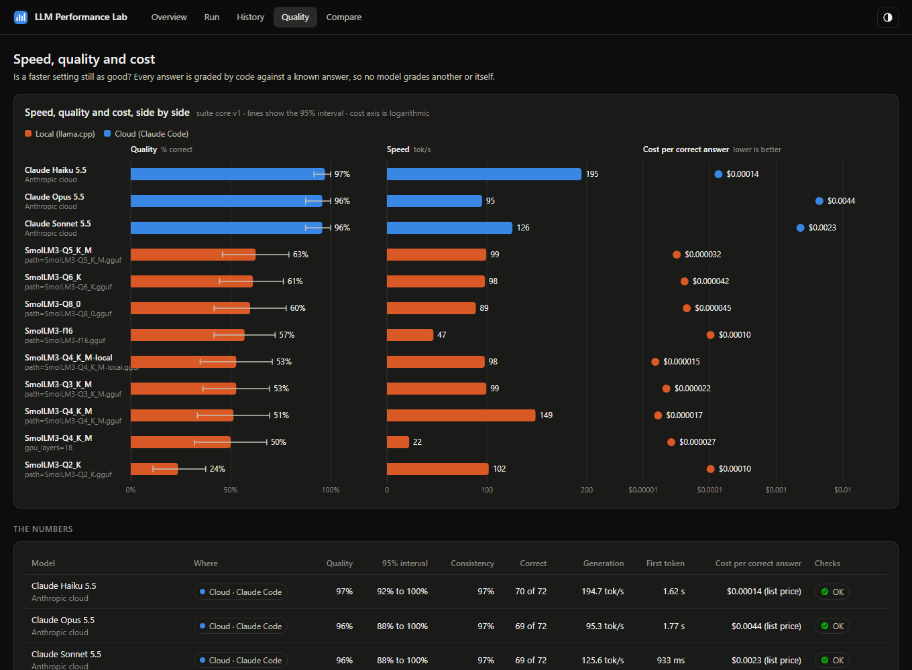
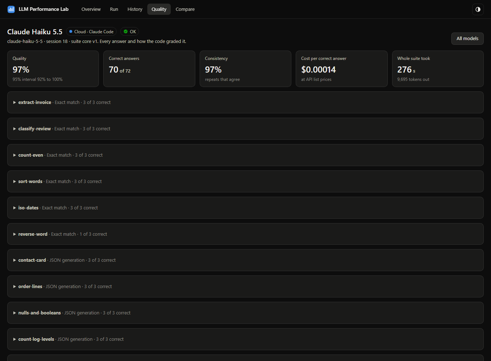
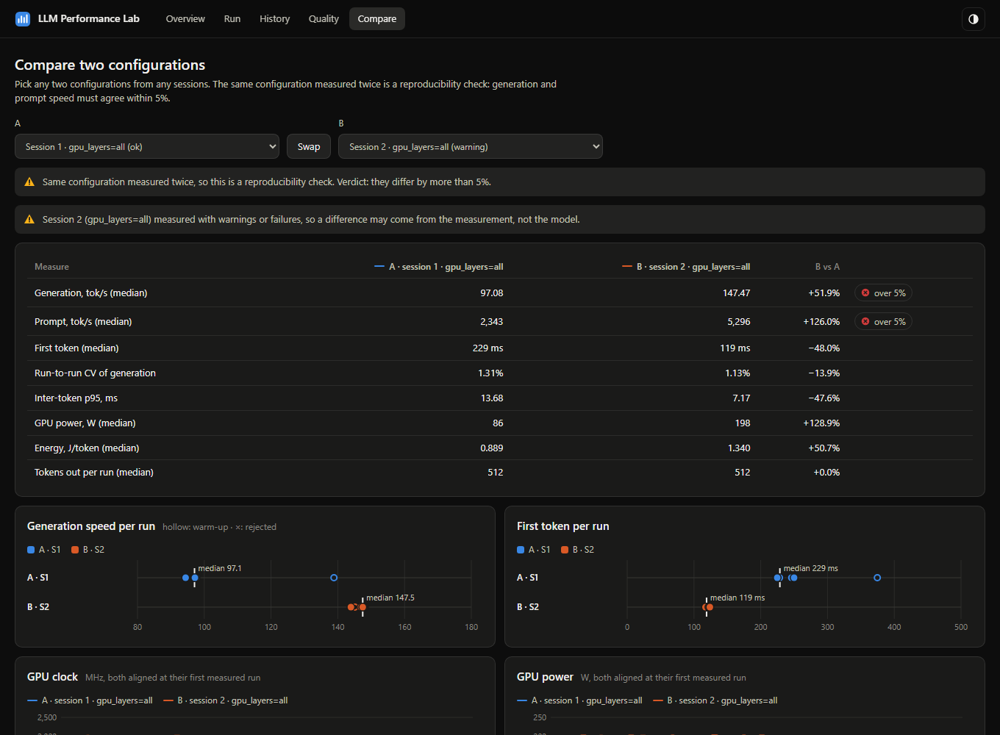
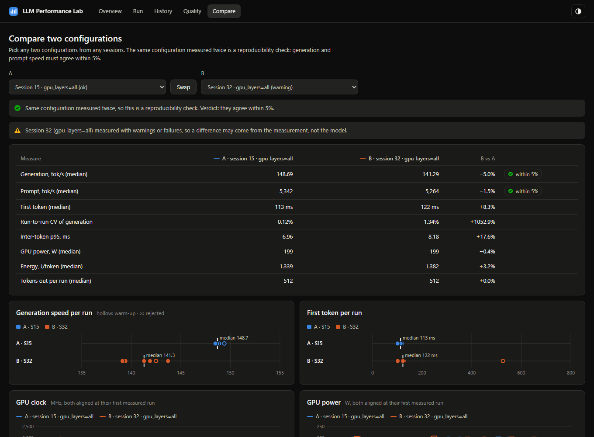

# Dashboard

A local web app over the lab's database. It starts runs, follows them live, and lets you browse and compare every session recorded.

```bash
uv run python -m llmlab dashboard
```

It opens `http://127.0.0.1:8765/` in your browser. `--port` picks another port and `--no-browser` skips opening one.

To look around without a GPU, a model or any setup, open it on the results recorded while this project was built ([demo/](../demo/README.md)). A "Demo" badge marks it, and starting runs is off:

```bash
uv run python -m llmlab demo
```

## Pages

| Page | Purpose |
|---|---|
| **Overview** | The headline: the fastest local configuration, local vs cloud speed and time to first token, and how many runs the trust checks rejected |
| **Run** | Pick an experiment file and start it. Watch each request's speed, the GPU clock, power and utilization, VRAM and per-core CPU live, with load, warm-up and measured runs shaded |
| **History** | Every session, newest first, with each configuration's status and speed |
| **Session** | One session in full: medians, the spread of runs, GPU telemetry over the whole session, every trust check with its evidence, and the exact settings and command |
| **Quality** | Speed, answer quality and cost side by side, then each model's results by category and task. Open a model to read every answer and how it was graded |
| **Compare** | Any two configurations side by side, with their GPU telemetry overlaid and aligned at the first measured run. The same configuration measured twice is a reproducibility check (within 5%). When both were scored, it also says whether quality differs beyond what the tasks can show |



The screenshots below are from the published copy of the results ([demo/](../demo/README.md)), so paths read `<repo>` and `~`.



The Run page during session 32, just after the model fully on the GPU finished its five runs: the clock holds near 2,000 MHz, power sits at the card's 200 W limit, and the brief dips are the 0.1 s pauses between runs.



A session keeps every run, the telemetry and every trust check with its evidence. Session 32 got a "CPU quiet" warning: other programs, the screen recorder among them, used up to 14% of the CPU during its runs, where the limit is 8%.





The Quality page sets speed, quality and cost side by side, with each measure on its own axis. Opening a model shows every answer and why it passed or failed.





The Compare page reproduces [finding 1](measurement-findings.md#1-pauses-between-runs-let-the-gpu-downclock) from the database: the same model with a 1-second pause between runs (A, session 1) and without (B, session 2).



The same configuration three days apart (sessions 15 and 32) is a reproducibility check. Generation speed came out 5.0% lower, just inside the 5% bar, and the page notes that session 32 has warnings that could explain the difference.



## How it works

- **No new dependencies.** The server is Python's standard library (`http.server`), and the page is plain JavaScript with hand-drawn SVG charts. There is nothing to build or install.
- **Runs are ordinary `llmlab run` processes.** The dashboard starts `python -m llmlab run FILE` with the same idle check, trust checks and database as a terminal run. A run started from a terminal shows up live in the dashboard too.
- **A live log connects them.** `llmlab run` writes one JSON event per line to `live/latest.jsonl` next to the database: the session, each configuration, each request's result, the end. The dashboard reads it once a second, together with the telemetry sampler's own file. Stop creates `live/stop`, and the runner stops cleanly before its next request, shutting the server down.
- **Watching costs about 0.3% of the CPU, measured.** The dashboard reads the database read-only, so it never blocks the runner's writes. The page redraws only when new data arrives, once a second during a run, and nothing on it animates. The first version's pulsing "Running" dot repainted the page 60 times a second, cost ten times as much, and slowed the run it was watching by 3% ([finding 10](measurement-findings.md#10-watching-a-run-live-slowed-it-down)). The Live charts switch turns the charts off entirely.
- **Live telemetry is for runs in progress.** A run deletes its telemetry files when it ends; from then on, everything is in its session page, which the Run page links to.

## Safety

- It listens on 127.0.0.1 only, and answers only requests addressed to `127.0.0.1` or `localhost`, so another website can't reach it through DNS tricks.
- It starts a run only for a JSON request from its own page, and only for a file in `experiments/`.
- Text from the database is always inserted into the page as text, never as HTML.

## API

| Method and path | Returns |
|---|---|
| `GET /api/overview` | Counts, and the latest result of each configuration |
| `GET /api/sessions` | Every session, with each configuration's headline numbers |
| `GET /api/sessions/ID` | One session: settings, summaries, every run, checks |
| `GET /api/configs/ID/timeline` | Telemetry, phases and run windows, in seconds from the configuration's start |
| `GET /api/configs/ID/log` | The full llama-server log |
| `GET /api/quality` | The latest quality run of each configuration, with speed and cost |
| `GET /api/quality/ID` | One configuration's quality run, with every graded answer |
| `GET /api/quality/compare?a=A&b=B` | Two configurations' quality, compared task by task |
| `GET /api/experiments` | The experiment files, checked as `run --dry-run` checks them |
| `GET /api/live?since=N` | The current run's state, its events after the first N, and new telemetry samples |
| `GET /api/status` | The current run's state, in brief |
| `POST /api/runs` | Starts `{"file": "NAME.yaml", "allow_busy": false}` |
| `POST /api/runs/stop` | Asks the current run to stop |
